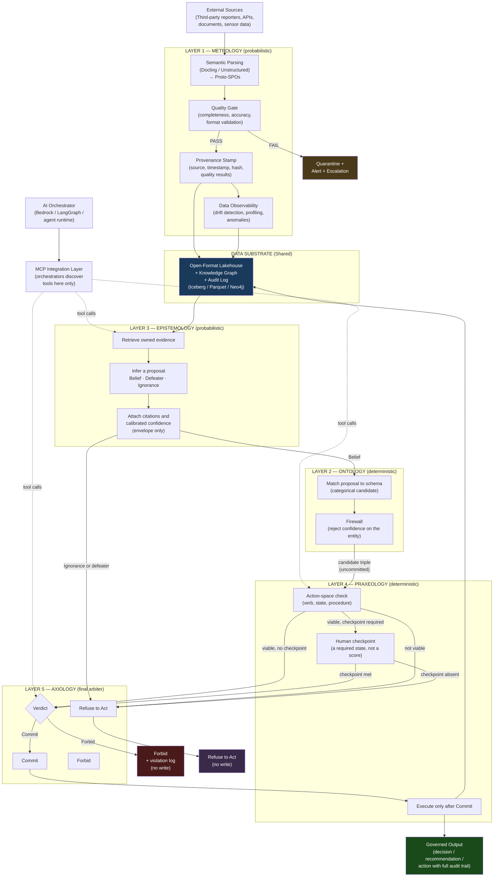

# Information Flow Across MOEPA Layers

How a case moves through the Philosophical AI Architecture: the probabilistic domain proposes, and the deterministic domain arbitrates. Nothing is committed until Axiology returns **Commit**.

---

## End-to-End Information Flow

---

## Key Handoffs Between Layers

### Metrology → Data Substrate
Every record that passes Metrology's quality gate is stored as an observation: value, unit, provenance, calibration, and error bounds. That write is not an entity commitment.

**What passes:** A qualified measurement  
**What gets added:** Observational lineage and disagreement flags

---

### Epistemology → Ontology
Epistemology reads owned evidence, including the standing schema, and emits one proposal: Belief, Defeater, or Ignorance. Ontology turns a Belief into an uncommitted candidate triple only when the schema matches. Confidence stays in the epistemic envelope.

**What passes:** A proposal  
**What gets added:** A categorical candidate, or a rejection if the write would put uncertainty on the entity

---

### Epistemology → Ontology → Praxeology
Epistemology emits one proposal. The epistemic state is Belief, Defeater, or Ignorance. Confidence, when present, stays in the envelope.

Ontology accepts a candidate triple only when it matches a discrete schema. It rejects any write that would put confidence on the entity. The candidate is not yet committed.

Praxeology then tests the action space: current state, allowed verb, and procedural preconditions. A human checkpoint is one of those preconditions. A confidence cutoff is not.

---

### Praxeology → Axiology → Output
Axiology is the final arbiter. It returns exactly one verdict:

- **Commit** — write the triple and perform the admitted action
- **Forbid** — the act violates a value or compliance rule; write nothing for that act
- **Refuse to Act** — the proposal is Ignorance, a defeater is unresolved, or a precondition is absent; write nothing and do not pretend a decision was made

**What passes:** An admitted candidate plus its epistemic envelope  
**What gets added:** The verdict, the rule id, and the compliance log entry

---

## What the Data Substrate Stores After Each Layer

| Layer | Records Written to Substrate |
|---|---|
| Metrology | Observations with provenance, calibration, and error bounds. Not entity commitments. |
| Epistemology | Proposals: epistemic state, citations, and confidence only inside the envelope. |
| Ontology | Categorical triples, and only when the verdict on that proposal is Commit. |
| Praxeology | Admission records: state, verb, precondition results. No confidence edge. |
| Axiology | Verdict records: Commit, Forbid, or Refuse to Act, with rule id. |

The Data Substrate accumulates observations and proposals immediately, and categorical facts only after Commit. Forbid and Refuse to Act are themselves durable records. They are not silent drops.

---

## MCP Integration Boundary

AI orchestrators (Bedrock Agents, LangGraph routers, policy-governed agent runtimes)
discover and invoke layer capabilities **only through MCP** — never by calling
data, RAG, or workflow APIs directly. Semantic ingestion, retrieval,
verification, workflow steps, and policy checks are each exposed as MCP servers
or facades. See [Architectural Governance Guidelines](../docs/MOEPA-Architectural-Governance-and-Evolution-Guidelines.md).
