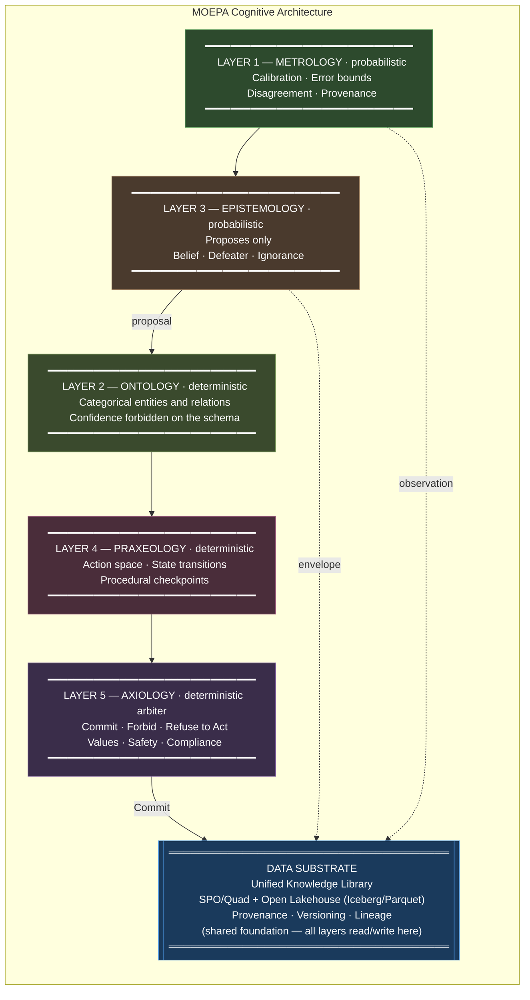

# MOEPA Stack Diagram

The MOEPA 5-Layer Framework inside the Philosophical AI Architecture, with the agency-owned Data Substrate foundation.

---

## Full Stack with Data Substrate

---

## Layer Definitions at a Glance

| Layer | Domain | AI Governance Role | Core Tool Examples |
|---|---|---|---|
| **5 — Axiology** | Deterministic arbiter | Commit, Forbid, or Refuse to Act | Open Policy Agent, Gatekeeper |
| **4 — Praxeology** | Deterministic | Which transitions are in the action space | LangGraph, Temporal, Camunda |
| **3 — Epistemology** | Probabilistic | Belief, Defeater, or Ignorance — proposal only | Owned RAG, calibrated inference |
| **2 — Ontology** | Deterministic | Categorical entities; no confidence on the schema | Neo4j, Apache Jena, Iceberg |
| **1 — Metrology** | Probabilistic | Calibration, error bounds, disagreement | Great Expectations, OpenLineage |
| **Data Substrate** | *(architectural pattern)* | Shared knowledge library; owned by the organization | Iceberg + Parquet + Neo4j + Atlas |

---

## The Governance Property of the Stack

Control runs from probabilistic proposal to deterministic arbiter. A weak layer fails in a specific way:

- If **Metrology** is weak, proposals rest on uncalibrated observations
- If **Epistemology** is weak, ignorance is flattened into a probability and handed downstream as if it were a belief
- If **Ontology** is weak, confidence leaks onto entities and existence becomes a score
- If **Praxeology** is weak, the action space is "whatever the model called"
- If **Axiology** is weak, a confidence score or a prompt is treated as permission

This is why the [5-Layer Evaluation Checklist](../docs/5-Layer-Evaluation-Checklist.md) uses the **lowest layer score** as the overall recommendation — not an average.

**Cross-cutting integration:** AI orchestrators access layer capabilities only through the **Model Context Protocol (MCP)** — not vendor glue code or direct data/RAG API calls. Semantic ingestion produces **Proto-SPOs** before records enter the substrate. See [Architectural Governance Guidelines](../docs/MOEPA-Architectural-Governance-and-Evolution-Guidelines.md).
