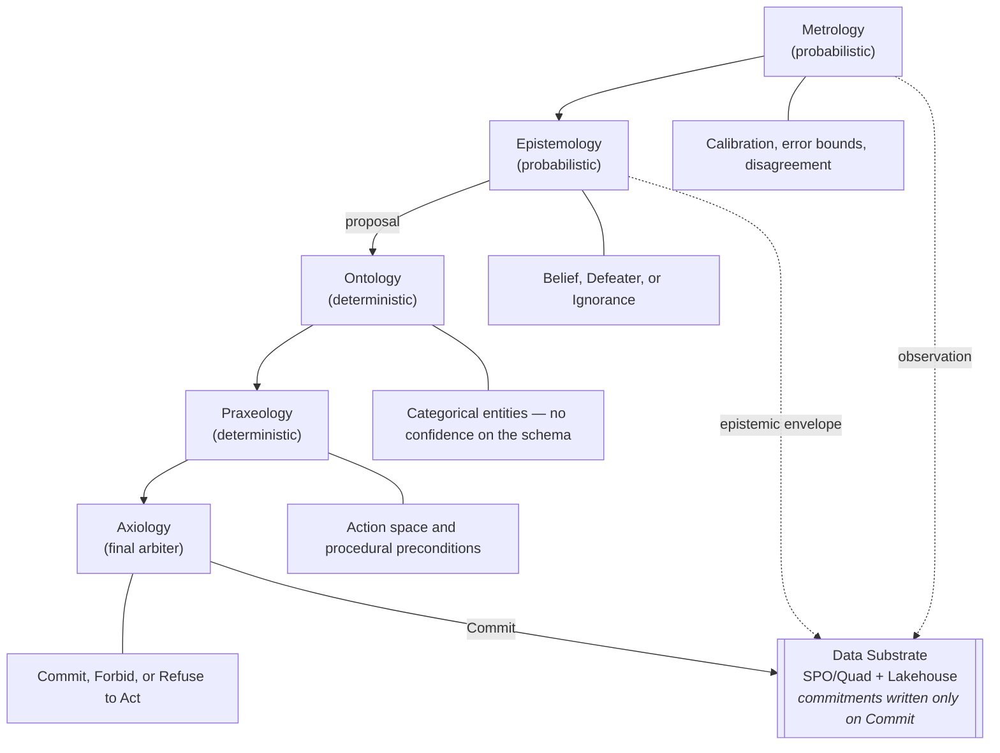

# Layered Architecture Diagram

This diagram shows the control flow of the MOEPA Cognitive Architecture. Metrology and Epistemology propose. Ontology, Praxeology, and Axiology govern. The **Data Substrate** stores observations and envelopes immediately, and categorical triples only after Axiology returns Commit. It is not a scored layer.

## Reading Guide

- **Data Substrate** holds the SPO/quad backbone and lakehouse. Observations and proposals may be stored before a verdict. A categorical triple is written on Commit. The substrate is **not** a scored layer.
- **Metrology** (probabilistic) qualifies observations: calibration, error bounds, disagreement.
- **Epistemology** (probabilistic) proposes Belief, Defeater, or Ignorance. It does not authorize action.
- **Ontology** (deterministic) accepts only categorical candidates. Confidence stays off the entity schema.
- **Praxeology** (deterministic) admits a transition only when the action space and its procedural preconditions hold.
- **Axiology** (deterministic, final arbiter) returns Commit, Forbid, or Refuse to Act.

## Why the flow is split

The probabilistic domain is allowed to be uncertain. The deterministic domain is not allowed to be unsure about permission.

1. **Metrology** measures.
2. **Epistemology** proposes, including the right to say "I don't know."
3. **Ontology** shapes a discrete candidate and refuses to store uncertainty as existence.
4. **Praxeology** tests viability.
5. **Axiology** commits, forbids, or refuses. Only Commit changes committed state.

## Design implication for AI architecture

- **Metrology:** How good is this observation?
- **Epistemology:** Is this a belief, a defeater, or ignorance?
- **Ontology:** What categorical thing would this be, if we committed it?
- **Praxeology:** Is that transition in the action space?
- **Axiology:** Commit, Forbid, or Refuse to Act?

The diagram is the control architecture: statistical inference may propose; discrete governance decides.
